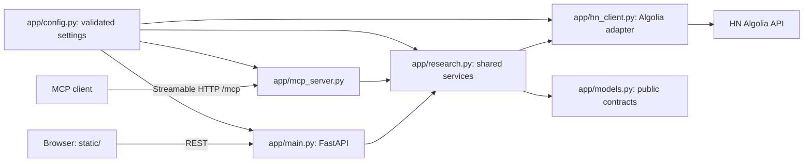

# Architecture contract

Status: Phase 0 design, 2026-10-14. This contract governs Phases 1–10 once the decisions in [Decisions needing approval](#decisions-needing-approval) are approved. The authoritative source prompts and checklist are restored in [phase-0-requirements.md](phase-0-requirements.md). **DESIGN ASSUMPTION** marks choices not established by validation. No application code or deployment is claimed.

## Evidence and scope

- [Technical validation: SDK package metadata](technical-validation.md#sdk-package-metadata), [integration and transport behavior](technical-validation.md#integration-and-transport-behavior), and [HTTP mocking decision](technical-validation.md#http-mocking-decision) establish the locally tested SDK behavior.
- [Deployment: live upstream measurements](deployment.md#live-upstream-measurements), [research request budget](deployment.md#worst-case-research_hn-request-budget), and [decision matrix](deployment.md#decision-matrix-and-phase-2-plan) establish retrieval and host feasibility evidence. Measured latency is a small sample, not a guarantee.
- The module, route, tool, and numeric-bound lists came from the supplied blueprint. Defaults, payload fields, ranking, and operational limits below are **DESIGN ASSUMPTIONS**.
- Scope: strictly $0, read-only HN research website plus remote MCP. No database, authentication, paid service, persistent cache, or model API. The lack of persistence also follows Render's ephemeral-file finding in [deployment: official hosting constraints](deployment.md#official-hosting-constraints).

## Topology and ownership



| Path | Responsibility and boundary |
| --- | --- |
| app/main.py | FastAPI factory, lifespan, REST and static routes, REST error translation. HN-facing REST routes only validate and call shared service functions; / and /health serve the UI and readiness response. No route contains HN HTTP, ranking, or research logic. Mount /mcp without swallowing /, /health, or /api/*. |
| app/config.py | Validate upstream URL, deadlines, concurrency, public Host and Origin allowlists. No network or business logic; invalid security settings fail startup. |
| app/models.py | Pydantic inputs/outputs, bounds, UTC serialization, safe upstream-to-public normalization and HTML-to-text conversion. Unknown upstream fields never leak. |
| app/hn_client.py | Own plain httpx.AsyncClient; perform Algolia search and item-tree GETs; enforce attempt timeouts, retries, error classification. No route, MCP, ranking, or theme logic. |
| app/research.py | Export async search_hn, get_hn_discussion, research_hn services; orchestrate calls, comment selection, ranking, themes, partial results. Both transports call these same functions. |
| app/mcp_server.py | Register the three tools, validate inputs, translate service errors, expose SDK ASGI app. Tools only call shared service functions. |
| static/ | Browser search, discussion, and research views; call /api/* only; render plain text safely. |
| tests/ | Contract, service, transport, and hosted smoke checks with mocked upstream requests. |

**DESIGN ASSUMPTION:** Each service receives validated inputs, an injected HN client, and an explicit reference time when scoring needs one. One inbound request owns its deadline and semaphore. There is no shared mutable research state.

## Public field contracts

All JSON uses snake_case. IDs are positive integers; timestamps are ISO 8601 UTC strings ending Z; nullable fields are present as null; arrays are present even when empty. **DESIGN ASSUMPTION:** these fields define version 1 because the blueprint names types but does not list their fields.

| Type | Fields and invariants |
| --- | --- |
| HNResult | id: int > 0; title: plain-text string (missing becomes "[untitled]"); url: absolute HTTP(S) string or null; hn_url: canonical HN story URL; author: string or null; points: nonnegative int; comment_count: nonnegative int from search when available, otherwise observed eligible descendants; neither guarantees tree completeness; created_at: UTC string or null; rank_score: float in [0,1], rounded to six decimals. |
| HNComment | id: int > 0; story_id: int > 0; parent_id: int > 0 or null if absent; author: string or null; text: sanitized plain text (empty/deleted comments excluded); created_at: UTC string or null; depth: nonnegative int (direct child is 0); hn_url: canonical comment URL. |
| HNDiscussion | story: HNResult; comments: HNComment[] in selected tree order; returned_comment_count: int equal to array length; truncated: bool true when more eligible comments were observed than returned. |
| ResearchEvidence | id: "comment:{comment_id}"; story_id: int; comment_id: int; author: string or null; excerpt: first at most 500 characters of cleaned comment text; hn_url: canonical comment URL; relevance_score: float in [0,1]. Every item traces to one HN comment. |
| ResearchTheme | label: extracted keyword string; keywords: string[] (one or more); evidence_ids: string[] resolving to ResearchEvidence in this result; support_count: number of distinct selected comments with the keyword, at least 2. Evidence IDs are unique. |
| ResearchResult | query: normalized string; generated_at: UTC string; stories: HNResult[] in rank order; themes: ResearchTheme[]; evidence: ResearchEvidence[]; scanned_story_count: successful item trees; scanned_comment_count: eligible comments considered; partial: bool; warnings: safe string[]. Empty arrays are valid. |

**DESIGN ASSUMPTION:** Flat comments plus parent_id/depth let clients rebuild nesting without recursive public JSON. Research is extractive: themes claim repeated terms, never consensus, sentiment, or causal conclusions. At most 50 selected comments per story may produce evidence, and each comment produces at most one evidence item. Algolia completeness remains a separate risk.

For search and research, HNResult fields and the relevance index come from the search hits; research item trees supply comments. For a direct discussion lookup, derive the story from its item tree and calculate rank_score as a single-item result (relevance = 1). This is a **DESIGN ASSUMPTION** needed because discussion has no search order.

### Error envelope

REST failures return exactly:

```json
{"error":{"code":"invalid_input","message":"Safe display text","retryable":false,"details":{}}}
```

code is stable; message has no traceback, upstream HTML, credentials, or internal exception text; retryable is boolean; details is an object containing only public field names and bounds. **DESIGN ASSUMPTION:** the mappings below are the public error policy.

| Condition | HTTP | code | retryable |
| --- | ---: | --- | --- |
| Invalid query, ID, limit, or extra parameter | 422 | invalid_input | false |
| Upstream item absent | 404 | not_found | false |
| Upstream rate limit | 503 | upstream_rate_limited | true |
| Upstream connection/HTTP failure | 502 | upstream_unavailable | true |
| Overall deadline | 504 | upstream_timeout | true |
| Unexpected internal failure | 500 | internal_error | false |

MCP schema violations use the SDK invalid-parameters protocol error. Known service failures become safe tool errors with text "code: message" and is_error=true; successful tool calls return the same typed JSON as REST in structured_content. The SDK's observed dict success, tool error without structured_content, protocol error, and redacted unexpected exception behavior is in [technical validation: integration and transport behavior](technical-validation.md#integration-and-transport-behavior). **DESIGN ASSUMPTION:** failed MCP tools do not promise a structured error envelope; the REST envelope is the canonical structured failure format.

## Entry-point schemas

Normalize a query with Unicode NFKC, trim and collapse whitespace, then require 1–300 Unicode code points. Limits must be integers within their range, never silently clamped. Reject extra query parameters or tool arguments. **DESIGN ASSUMPTION:** names/defaults below fill blueprint gaps; ranges are from the blueprint.

| REST endpoint | Inputs | Success |
| --- | --- | --- |
| GET / | None. | HTML 200 from static/. |
| GET /health | None; no upstream fetch. | {"status":"ok"} 200 when app lifespan is ready. |
| GET /api/search | q required string 1–300; limit optional int 1–30, default 10. | {"query":str,"results":HNResult[]} 200, at most limit results. |
| GET /api/discussions/{id} | id required positive decimal int; comment_limit optional int 1–50, default 20. | HNDiscussion 200. |
| GET /api/research | q required string 1–300; limit optional int 1–15, default 5 stories; comment_limit optional int 1–50, default 20 per story. | ResearchResult 200. |

/mcp is the SDK Streamable HTTP mount, not a REST route. Each tool has an object input schema with no additional properties and returns the listed JSON object as structured content:

| MCP tool | Input fields | Success |
| --- | --- | --- |
| search_hn | query: required string 1–300; limit: optional int 1–30, default 10. | {"query":str,"results":HNResult[]} |
| get_hn_discussion | id: required int > 0; comment_limit: optional int 1–50, default 20. | HNDiscussion |
| research_hn | query: required string 1–300; limit: optional int 1–15, default 5; comment_limit: optional int 1–50, default 20. | ResearchResult |

## Retrieval, budgets, and failure policy

Use Algolia GET /api/v1/search with tags=story for discovery and GET /api/v1/items/{id} once per selected story. Select at most 50 comments locally from each returned nested tree. This follows [deployment: request budget](deployment.md#worst-case-research_hn-request-budget) and [decision matrix](deployment.md#decision-matrix-and-phase-2-plan). The documented maximum research path is 1 search + 15 trees = 16 first attempts; a Firebase per-comment path would require 766 calls in the same 15-story/50-comment scenario. The Algolia item endpoint has no observed server-side 50-comment limit. Never fan out per comment.

| Service at its upper input bound | First-attempt calls | Maximum with one retry each | Concurrency |
| --- | ---: | ---: | ---: |
| Search | 1 | 2 | 1 |
| Discussion | 1 item tree | 2 | 1 |
| Research | 1 search + 15 trees = 16 | 32 | At most 6 simultaneous item-tree GETs |

**DESIGN ASSUMPTION:** Use a six-request semaphore per inbound research call, aligning conservatively with Cloudflare's six connections waiting for headers in [deployment: official hosting constraints](deployment.md#official-hosting-constraints). Disable automatic redirects so they cannot add hidden subrequests. Do not add a Firebase fallback in this version. If a selected tree fails after retry and another succeeds, return partial=true plus a safe warning. Search failure, or failure of every selected tree, returns an error. Empty search results succeed with empty arrays and partial=false. Discussion fetch failure returns an error.

**DESIGN ASSUMPTION:** Every HTTP attempt has a hard 8-second wall deadline; each whole service call has a 30-second wall deadline. Retry GET once after 0.25 seconds for connection errors, attempt timeout, HTTP 429, 502, 503, or 504. Do not retry other 4xx, schema errors, or cancellation; never start a retry after the overall deadline. At the deadline, cancel unfinished trees and mark them partial if another tree succeeded. These are project limits, not measured guarantees. The sampled large tree took 2.428 seconds and the idealized 15-tree path was calculated at 7.976 seconds, with end-to-end performance explicitly unverified in [deployment: live upstream measurements](deployment.md#live-upstream-measurements) and [request budget](deployment.md#worst-case-research_hn-request-budget).

## Ranking and research derivation

**DESIGN ASSUMPTION:** Algolia search order provides an ordinal relevance signal. With N returned hits and original zero-based index i, compute:

```text
relevance    = 1                         if N = 1
             = 1 - i / (N - 1)           if N > 1
             = 0                         if N = 0
points_norm  = min(1, ln(1 + max(0, points)) / ln(501))
comments_norm= min(1, ln(1 + max(0, comment_count)) / ln(201))
engagement   = (points_norm + comments_norm) / 2
age_days     = max(0, (reference_time - created_at) / 86400 seconds)
freshness    = exp(-age_days / 30) if created_at exists, else 0
rank_score   = round(0.50 * relevance + 0.30 * engagement + 0.20 * freshness, 6)
```

N is the number of hits returned for this request and i is each hit's position in Algolia order. The score is therefore request-relative; use rank_score only to compare stories in the same response. A different limit can change a story's score even when its underlying position is unchanged. Normalize missing/invalid points and comment_count to zero; parse created_at into UTC, with missing/invalid date giving zero freshness and future date giving zero age. Use natural log and ordinary floating-point math. Sort by unrounded score descending, original Algolia index ascending, then story ID ascending. The 500-point, 200-comment, 30-day scales and weights are **DESIGN ASSUMPTIONS**, not HN/Algolia scoring facts. Review fixture outcomes in Phase 4 before release.

**DESIGN ASSUMPTION:** Flatten each item tree in upstream depth-first order. Exclude empty/deleted comments; decode entities, strip markup, and collapse whitespace. Discussion returns the first comment_limit eligible comments in tree order. For research, tokenize query and comment with NFKC, casefold, and Unicode word boundaries; retain all tokens of at least three characters, with no stop-word removal. Calculate query_overlap = number of distinct query tokens present in the comment-token set divided by number of distinct query tokens; an empty query-token set yields zero. Sort candidate comments by overlap descending, depth ascending, then tree index; select at most comment_limit per story. ResearchEvidence.relevance_score is rounded query_overlap; excerpt is the first 500 characters. Each term occurring in at least two distinct selected comments may form a theme with label equal to that term and keywords=[label]. Emit at most 10 themes by support_count descending then label ascending, and at most 10 evidence IDs per theme by evidence relevance descending, story rank descending, then comment ID ascending. support_count includes all selected supporting comments even when evidence IDs are capped.

Tests freeze reference_time to an explicit UTC instant and use fixtures for Algolia order, points, comments, timestamps (including future/missing), HTML, ties, and duplicated terms. Assertions cannot depend on the machine clock, live HN data, or unstable upstream ordering. The same fixtures must yield equivalent public JSON through REST and MCP, excluding transport framing.

## Runtime and hosting decisions

| Decision | Binding choice and evidence |
| --- | --- |
| Python version | Target Python 3.13. **DESIGN ASSUMPTION:** it accommodates Cloudflare's Python >=3.13 examples in [deployment: official hosting constraints](deployment.md#official-hosting-constraints). SDK v2.3.0 package metadata observed in the spike says >=3.10; current SDK install docs say Python 3.11+. It was exercised on 3.12.3 in [technical validation: SDK package metadata](technical-validation.md#sdk-package-metadata); full-app 3.13 behavior remains unverified. |
| HTTP client | Explicit plain httpx for HN; SDK-managed httpx2 for MCP. Local coexistence was verified; do not pass plain httpx clients into SDK APIs expecting httpx2 ([technical validation: SDK package metadata](technical-validation.md#sdk-package-metadata)). |
| Mocking | respx with plain httpx for HN; httpx2.MockTransport for SDK HTTP. Both were exercised in [technical validation: HTTP mocking decision](technical-validation.md#http-mocking-decision). |
| MCP mode | Set stateless_http=True. Legacy and modern clients both worked locally without session IDs; multiworker routing remains unverified ([technical validation: integration and transport behavior](technical-validation.md#integration-and-transport-behavior)). |
| Transport security | Configure TransportSecuritySettings with exact public hostname (including port where needed) and explicit loopback development hosts; allow only deliberately supported browser origins. No wildcard public Host. Explicit allowlisting fixed the observed 421; browser CORS and Origin remain untested ([technical validation: integration and transport behavior](technical-validation.md#integration-and-transport-behavior)). **DESIGN ASSUMPTION:** environment supplies actual host/origin values. |
| Lifespan | FastAPI lifespan owns HN httpx.AsyncClient and enters mcp.session_manager.run() for ASGI service life, closing both on shutdown. Session-manager wiring was verified locally beside /health and /mcp; adding the HN client is a **DESIGN ASSUMPTION** ([technical validation: integration and transport behavior](technical-validation.md#integration-and-transport-behavior)). |
| Hosting | Render Free is a provisional native-Python baseline; Cloudflare Workers Free gets a one-working-day Phase 2 compatibility experiment with ten gates. Neither host is production validated ([deployment: decision matrix and Phase 2 plan](deployment.md#decision-matrix-and-phase-2-plan)). Strict $0 means no payment method or paid upgrades. |

## Phase acceptance criteria

These testable gates are **DESIGN ASSUMPTIONS** for the requested Phases 1–10: a separate phase blueprint is not in the repository. Passing local tests never implies a hosted gate passed.

| Phase | Acceptance criterion |
| --- | --- |
| 1. Foundation | Python 3.13 environment installs dependency ranges; all app modules import; app starts; /health returns 200; invalid config fails startup; imports make no HN request. |
| 2. Hosting feasibility | Run and record all ten Cloudflare gates in [deployment: Phase 2 plan](deployment.md#decision-matrix-and-phase-2-plan) within one working day; an unavailable metric stays unverified. Check a Render Free path without payment method or document why it cannot be exercised. Obtain approval before host switch/public deployment. |
| 3. HN adapter | Mocked search/item requests cover valid, missing, malformed, 404, 429, 5xx, timeout, redirect, retry, and cancellation cases; each logical GET uses at most two attempts; no per-comment HTTP fan-out. |
| 4. Models and ranking | Schema tests cover every field and bound; frozen-time fixtures check exact formula, tie order, future/missing timestamps, HTML-to-text, and deterministic theme/evidence IDs. |
| 5. Shared services | Direct tests show success, empty, partial, and failure for all three services; 15-story/50-comment fixture returns at most 15 stories and 50 selected comments per tree with at most six concurrent item GETs and 32 total upstream attempts. |
| 6. REST | /, /health, /api/search, /api/discussions/{id}, and /api/research match success/error contracts; 422 tests cover query lengths 0/1/300/301, every limit's min/max/outside values, and rejection of unknown query parameters. |
| 7. MCP | Official SDK client lists exactly the three named tools; modern and legacy clients call them at /mcp in stateless mode; invalid parameters, unknown arguments, and safe tool errors match contract. |
| 8. Browser UI | Search, discussion, and research views render fixture-based loading, empty, partial, and error states; comment/title text inserts safely; keyboard can reach controls and source links. |
| 9. Integration and deployment | One host serves REST, static UI, and /mcp over public HTTPS; real Host allowlist and lifespan work; external SDK client lists/calls tools; full 15-story path records wall time, calls, memory, and applicable host limits. |
| 10. Release | Contract/regression tests pass; README documents $0 deploy, settings, bounds, and limits; smoke logs are recorded; unmet host/data-quality gates remain explicitly open. |

## Decisions needing approval

The blueprint lists Cloudflare as a candidate but does not record approval for a host change. These deviations/commitments need user approval before replacing blueprint expectations:

1. **Cloudflare time box and Render baseline:** limit the Cloudflare Workers Free experiment to one working day, then use Render Free as provisional deployment baseline if a gate fails. This is a recommendation, not a completed deployment ([deployment: decision matrix and Phase 2 plan](deployment.md#decision-matrix-and-phase-2-plan)). Approval precedes a final host switch or public deployment.
2. **Algolia-only trees:** use one nested /items/{id} call per story with no unbounded Firebase per-comment fallback. The 16-versus-766 calculation supports the budget, while data completeness is unverified ([deployment: request budget](deployment.md#worst-case-research_hn-request-budget)).
3. **Research semantics:** deterministic keyword themes and linked comment excerpts, with no generated prose/model API. This is a **DESIGN ASSUMPTION** because the supplied blueprint names research_hn without defining its semantic output.

Parameter names/defaults, ranking weights, and timeout values are also **DESIGN ASSUMPTIONS** specified for review. Altering the public contract after acceptance needs an architecture revision; any blueprint change needs user approval.

## Remaining risks

- **Algolia completeness and scale:** sampled search counts, Algolia descendants, and Firebase child counts disagreed; cause unknown. Large trees can consume CPU/memory before local pruning ([deployment: live upstream measurements](deployment.md#live-upstream-measurements) and [request budget](deployment.md#worst-case-research_hn-request-budget)). Measure resource use and compare representative trees before claiming completeness.
- **Cloudflare runtime fit:** Python/SDK dependencies, ASGI lifespan, MCP streaming, CPU, memory, startup, and bundle fit are unverified on Workers; ten Phase 2 gates remain ([deployment: decision matrix and Phase 2 plan](deployment.md#decision-matrix-and-phase-2-plan)).
- **Render operations:** outbound-traffic suspension threshold is unpublished; documented roughly one-minute cold start has untested effect on real MCP clients ([deployment: official hosting constraints](deployment.md#official-hosting-constraints)).
- **Security/protocol edges:** browser CORS/Origin, public HTTPS, shutdown/cancellation, and multiworker behavior were not exercised in the local SDK spike ([technical validation: integration and transport behavior](technical-validation.md#integration-and-transport-behavior)).
- **Extractive quality:** keyword frequency can miss synonyms, sarcasm, and minority views. Research is traceable to comments, but no semantic-quality benchmark exists; Phase 4 needs representative fixtures and Phase 10 must publish the limitation.
